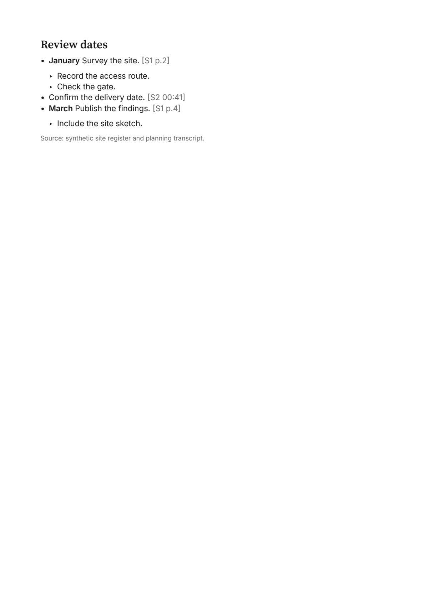
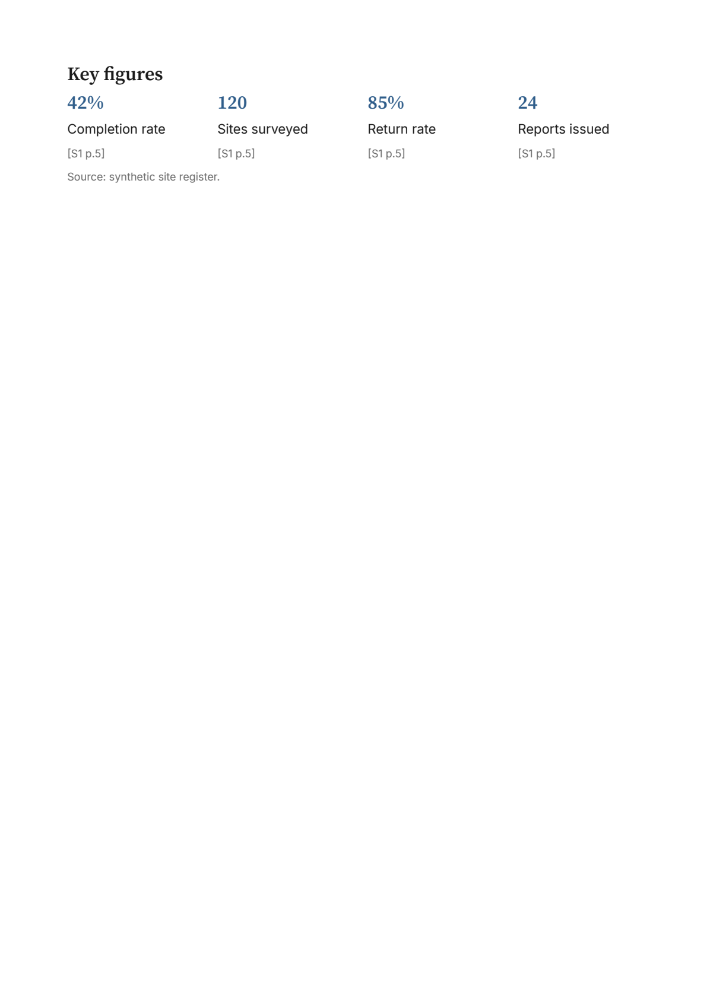

# Document lists and key figures

These pages were rendered through `ai-docs-kit build` from the component fixtures
in `tests/fixtures/components/`, using the neutral theme. Each fixture was
serialised into its own document with synthetic sources. The PDF is generated
in a temporary folder; only its rendered page is retained here for pull request
review.

All wording and figures are synthetic. The fonts are the kit's existing Inter
and Source Serif 4 fonts, licensed under the SIL Open Font Licence as recorded in
`src/ai_docs_kit/themes/neutral/fonts/LICENSES.txt`. No new font or outside asset
was added.
