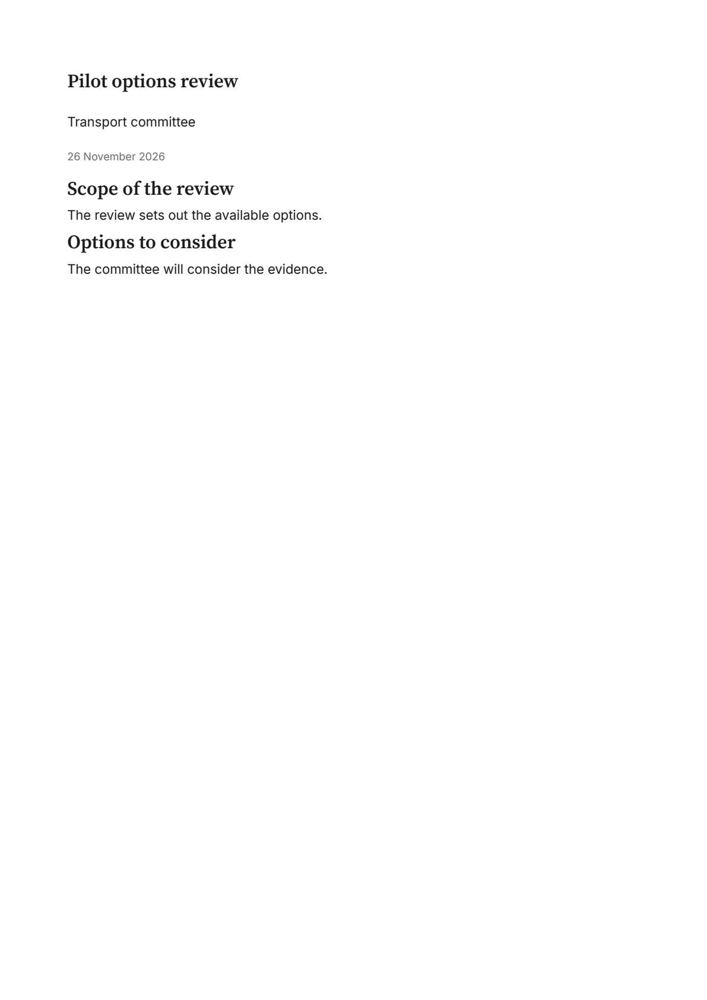
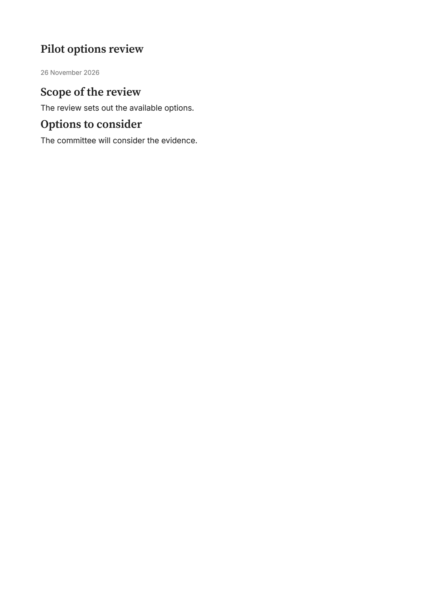
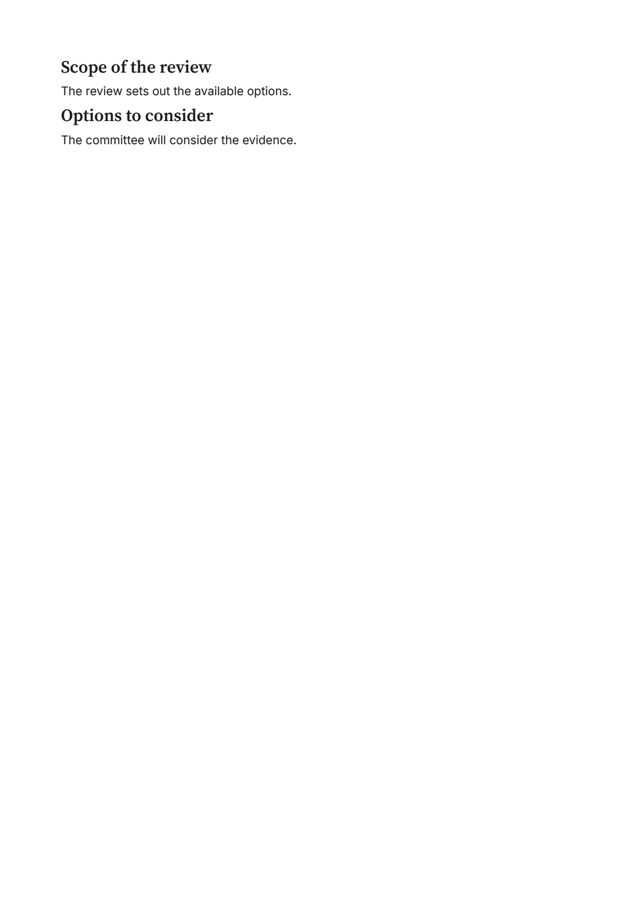

# Document title blocks

These first pages were rendered through `ai-docs-kit build` with the neutral
theme and a fixed build date of 26 November 2026. The source documents contain
two synthetic body sections. PDFs and build records remain in the build's
temporary folder; the rendered pages are retained here for pull request review.

All wording is synthetic and these renderings are original project material
under the repository's MIT licence. The fonts are the kit's existing Inter and
Source Serif 4, licensed under the SIL Open Font Licence as recorded in
`src/ai_docs_kit/themes/neutral/fonts/LICENSES.txt`. No new font or outside asset
was added.
