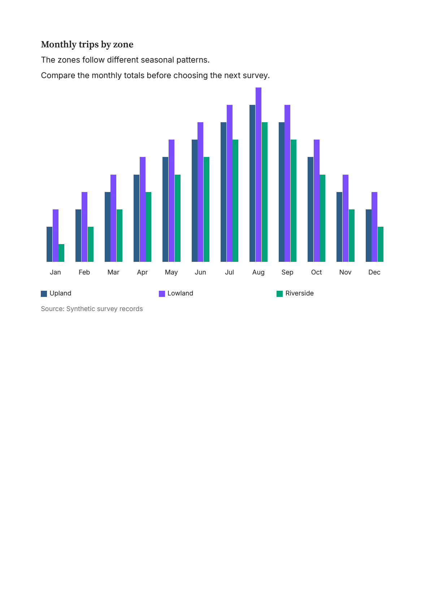
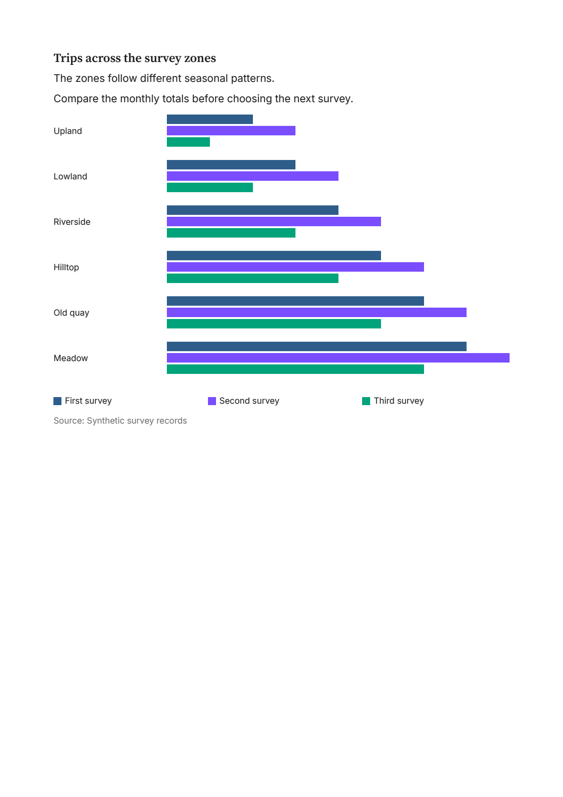
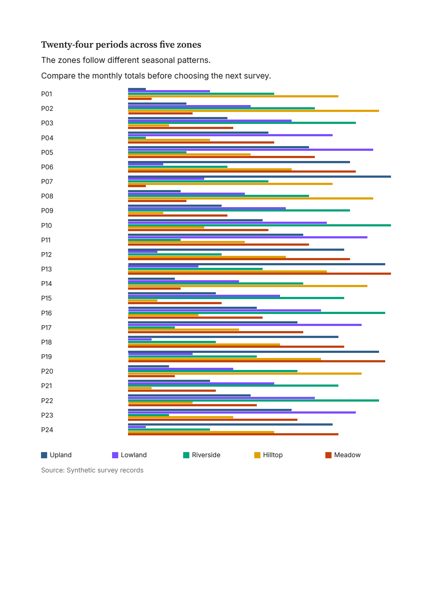
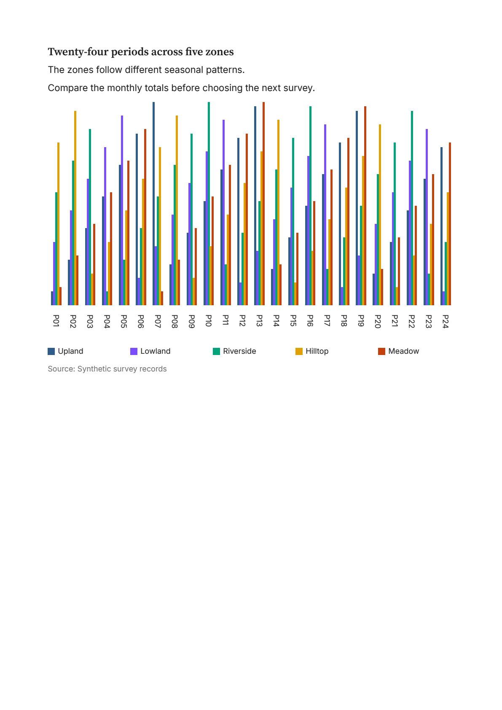
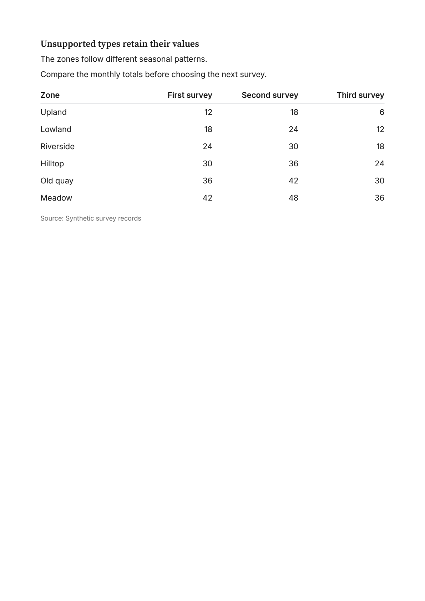

# Document bar and column charts

These pages were rendered through `ai-docs-kit build` with the neutral theme.
Each Markdown file beside its page is the synthetic source for that build.
PDFs, editable copies and build records stay in the build's temporary folder.

The capacity examples draw all 120 values. Column labels reserve a gap before
choosing whether to rotate, so adjacent category words remain distinct in PDF
text extraction as well as on the page. Prose follows working-file order and
the source line follows the chart or table.

All wording and data are synthetic, and these renderings are original project
material under the repository's MIT licence. The existing Inter and Source
Serif 4 fonts are licensed under the SIL Open Font Licence, recorded in
`src/ai_docs_kit/themes/neutral/fonts/LICENSES.txt`. No outside asset or new font
was added.
