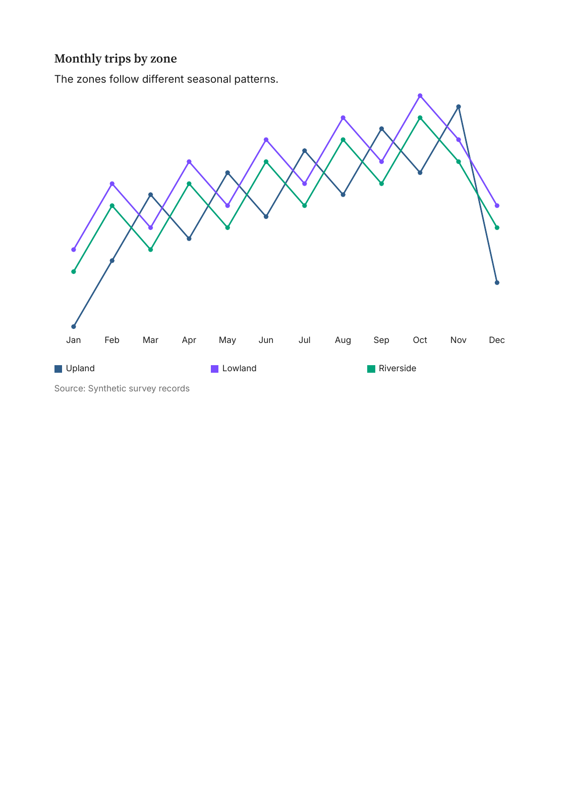

# Document line chart

This page was rendered through `ai-docs-kit build` with the neutral theme from
the synthetic working file beside it. It shows 12 ordered categories and three
series, including a negative value, with category labels and a legend.
The source uses the normal chart chooser, with no component override.

The locked `tests/test_doc_line_chart.py` checks the connecting PDF paths,
point field paths and positions, reversed categories and series, signed values,
selected-theme colours, findings and unchanged slide behaviour. It also compares
the new component fixture's golden against `scripts/golden_facts.py`.
The rendered page was inspected for legible labels, clipping and overlaps.
PDFs, editable copies and build records stay in the build's temporary folder.

All wording and data are synthetic, and this rendering is original project
material under the repository's MIT licence. The existing Inter and Source
Serif 4 fonts are licensed under the SIL Open Font Licence, recorded in
`src/ai_docs_kit/themes/neutral/fonts/LICENSES.txt`. No outside asset or new font
was added.
